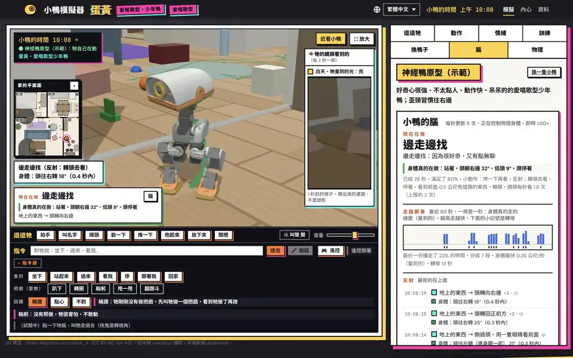
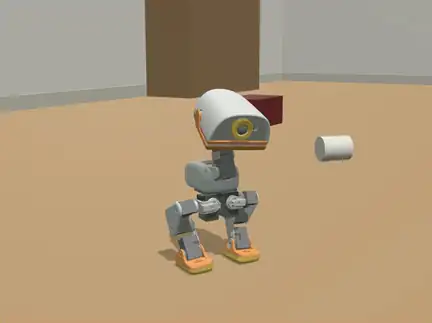
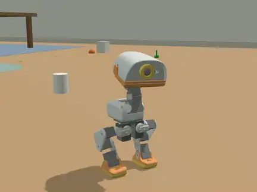
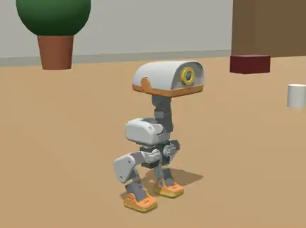
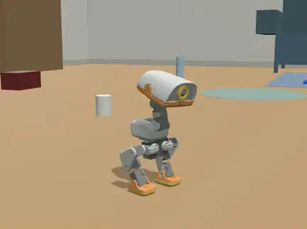
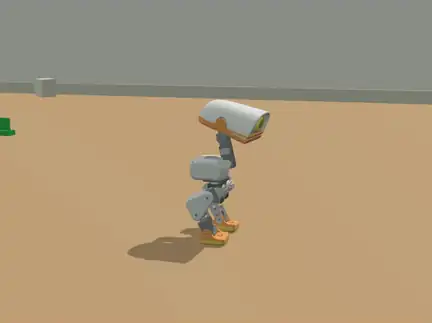
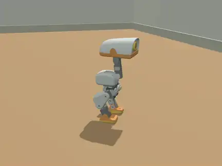

[English](README.md) | [繁體中文](README.zh-Hant.md) | [简体中文](README.zh-Hans.md) | [Español](README.es.md) | **Français** | [日本語](README.ja.md) | [한국어](README.ko.md)

# duckmind

duckmind donne à un petit canard robot un esprit à lui : qui il est, son humeur, ses
souvenirs, les personnes qu'il connaît, ce qu'il veut faire et ce qu'il apprend. Il
est écrit pour les robots compatibles avec Microduck et fournit un simulateur qui
s'ouvre dans le navigateur.

> **Projet non officiel.** duckmind n'est ni affilié à Pollen Robotics, ni approuvé,
> ni parrainé par Pollen Robotics. Microduck est un nom de Pollen Robotics. duckmind
> utilise le code open source, le modèle du robot et les politiques de Pollen, que
> vous téléchargez depuis leurs sources d'origine pendant l'installation.

## Le voir

<p align="center"><a href="docs/media/video/simulator.mp4"></a></p>

<p align="center"><sub>Un vrai enregistrement de la page du simulateur (la page est en 繁體中文), sans mise en scène : d'abord le canard vit tout seul (il se promène, s'assoit, mordille, regarde autour de lui, et la carte « ce qu'il fait » et son cerveau montrent ce qu'il décide) ; puis il se tourne quand on l'appelle par son nom, s'assoit et se relève quand on le lui demande, fait une révérence qu'il apprend encore et reçoit un compliment (l'onglet d'entraînement monte à 6 %), sursaute à un clap, et la caméra s'approche puis la vue s'agrandit. Monté à partir de trois enregistrements de la même séance ; rien d'autre n'a été changé. <a href="docs/media/video/simulator.mp4">Voir en pleine qualité (MP4, 59 s)</a>.</sub></p>

|  |  |  |
|:---:|:---:|:---:|
| Marcher | Révérence | Se coucher |
|  |  |  |
| Tourner | Roulade | Se relève après une chute |

Toutes les captures et les clips : [docs/media](docs/media/README.md) (licence CC BY-NC-SA 4.0, car ils montrent le modèle 3D Microduck de Pollen). Tout ce que le canard sait faire, par catégorie (en anglais) : [docs/motions.md](docs/motions.md).

## État

- **Simulateur : fonctionne.** Le canard vit, grandit, se promène dans une maison
  simulée et se souvient des personnes, sur votre ordinateur.
- **Robot réel : non validé.** duckmind n'a pas été testé sur un vrai robot. La
  version pour la carte n'est qu'une candidate. Lisez d'abord [SAFETY.md](SAFETY.md).

## Ce que c'est

duckmind décide *ce que* le canard veut faire. Il ne pilote pas les moteurs. Le
`robotd` de Pollen et ses politiques entraînées font bouger le corps, et leurs règles
de sécurité gardent le dernier mot :

```text
cognition -> behavior intent -> embodied skill -> robotd -> policy -> safety -> body
                                      ^                              |
                                      +-------- robot.state --------+
```

Dans le simulateur, la physique MuJoCo remplace le corps sous `robotd` : les couches
du dessus sont donc les mêmes dans le simulateur et sur un vrai robot.

## Ce que ce projet veut faire

En une phrase : **qu'un petit canard robot grandisse peu à peu jusqu'à devenir un animal qui appartient vraiment à votre famille.**

- Ce n'est pas un jouet télécommandé, ni un robot qui joue un scénario. Chacun de ses gestes, il le décide lui-même, après avoir « remarqué quelque chose et voulu quelque chose ».
- Il n'a que ses propres sens : ses yeux (la caméra), ses oreilles, un capteur de distance et les sensations de son corps. Les « bonnes réponses » du simulateur (où sont vraiment les choses, à quoi ressemble la carte), il ne les voit jamais, comme un vrai canard.
- **Le canard neuronal, c'est l'interface vivante ; grandir, c'est le cœur.** Les réactions de chaque instant (sursauter, être curieux, avoir sommeil, vouloir jouer) viennent du cerveau du « canard neuronal » ; ce qu'il devient jour après jour vient du système de croissance de « Duck Core ». Il faut les deux.

### Chaque canard est unique : la graine aléatoire

- À l'éclosion, il reçoit un nombre, sa « graine ». La même graine donne les mêmes gènes ; une autre graine, c'est un autre canard.
- La graine fixe ses tendances de caractère au départ (plutôt collant, plutôt explorateur, plutôt lent et rêveur…), la vitesse et la part de hasard de ses mouvements, et un répertoire de cris bien à lui.
- La graine n'est qu'un point de départ. Ce qui lui arrive ensuite, et la façon dont la famille le traite, le font « diverger » dans des directions différentes : confiez la même graine à deux familles et, au bout d'un moment, vous aurez deux canards différents.
- Même graine et mêmes expériences donnent le même résultat. Cela rend la recherche et le débogage possibles, et permet de comprendre « pourquoi il est devenu comme ça ».

### L'élever : il grandit vraiment

- Son âge se compte en « jours de croissance », pas en heures allumé : une journée ne compte que s'il est resté éveillé assez longtemps.
- De poussin à caneton, jeune canard puis canard adulte, il débloque de nouvelles choses. Par exemple, le salto arrive en général vers le stade jeune canard (environ 45 jours de croissance) ; le jour exact dépend de la vitesse à laquelle chaque canard grandit.
- La façon dont vous vous en occupez influence le type de canard qu'il devient : explorateur, rêveur, câlin ou chanteur.
- Il se souvient : des gens qu'il connaît, de ce qu'il aime, des endroits où il est tombé et qu'il vaut mieux éviter, de la forme de la maison.
- Ses cris évoluent de génération en génération (une lignée de cris) : il commence par babiller, les sons que la famille salue d'un « c'est bien ! » sont gardés, et peu à peu ils deviennent sa propre chanson.
- On peut lui apprendre des tours : demandez-le-lui, félicitez-le ou donnez-lui une friandise dès qu'il réussit, et il s'améliore à force de s'entraîner. Sans entraînement il se rouille, mais il n'oublie jamais complètement ce qu'il a appris.

### Du simulateur au vrai corps : un jour, on pourra le « graver » dans un vrai canard

- Pour l'instant, tout tourne dans un simulateur physique sur votre ordinateur (MuJoCo plus la simulation de robotd de Pollen). La physique du corps, le délai des moteurs et la batterie sont simulés au plus près d'un vrai Microduck.
- **Un canard, c'est un fichier** : sa graine, ses gènes, son historique de croissance, ce qu'il a appris, ses cris. L'objectif de conception : un canard élevé dans le simulateur, une fois relié à un vrai Microduck, reste le même canard dans un vrai corps ; nom, caractère, souvenirs et tours sont toujours là.
- Le cerveau peut rester sur l'ordinateur de la maison pendant que le corps devient un vrai petit canard ; c'est le même programme de cerveau, seuls le corps et le calibrage des sens changent.
- **Pour être honnête :** le petit canard n'a pas encore été validé sur du vrai matériel ; « l'export/import du fichier du canard » et le « corps à distance » sont des fonctions prévues. Voir la section État plus haut et [SAFETY.md](SAFETY.md).

### Ce qu'on peut déjà faire

- **Jouer avec lui :** taper dans les mains, l'appeler par son nom, lui caresser la tête, lancer une balle, le prendre dans les bras, éteindre la lumière, et regarder comment ses réflexes et ses émotions réagissent.
- **Lui donner des ordres (dans les six langues de la page) :** assis, debout, viens, regarde-moi, stop, suis-moi, à la maison ; toucher le sol pour l'y envoyer (expérimental) ; ou passer en mode télécommande.
- **Lui apprendre des tours :** couché, révérence, s'ébrouer, tourner, salto ; l'onglet d'entraînement (« Training » en anglais) montre à quel point il maîtrise chacun.
- **Voir ce qui se passe dans sa tête :** ce qu'il veut faire maintenant, pourquoi, s'il a peur, où il en est de sa croissance.
- **Aménager la maison :** placez vous-même les meubles, les seuils de porte et les tapis, et regardez comment il franchit les seuils, contourne les murs et retrouve le chemin de la maison.
- **Entraîner de nouveaux mouvements :** entraînez de nouveaux réseaux de mouvement avec les mêmes outils (mjlab, sur une A100 ou sur votre machine) et ajoutez-les à sa liste de mouvements.
- La liste complète des mouvements est dans [docs/motions.md](docs/motions.md) (繁中 : [docs/motions.zh-Hant.md](docs/motions.zh-Hant.md)).

## Comment ça marche

Le cerveau du canard a deux vitesses : des arcs réflexes rapides (sursaut, se figer, se relever, s'arrêter en trébuchant) qui agissent tout de suite, et un « cortex » plus lent où besoins et émotions s'affrontent pour choisir quoi faire, avec un peu de hasard à graine. Il ne perçoit qu'avec ses propres capteurs, se souvient par couches (de cet instant aux lieux et aux personnes qu'il a appris, jusqu'à un journal d'événements qui dure toute sa vie) et grandit au fil des jours. Les détails, et une liste honnête de ce qui ne marche pas encore, sont dans [docs/how-it-works.md](docs/how-it-works.md) (en anglais).

## La page du simulateur parle six langues

La page du simulateur existe en 繁體中文 (la langue par défaut), English, 日本語,
Español, 简体中文 et 한국어. Changez de langue sur la page : tout ce qu'affichent la
page, le serveur et le cerveau du canard suit. Les noms donnés par la famille (le nom
du canard, les noms des personnes) restent tels quels. (Le français n'est pas encore
une langue de la page.)

## Démarrage rapide

Il vous faut Python 3.12 ou plus récent, `git` et [`uv`](https://docs.astral.sh/uv/).

```bash
git clone https://github.com/joseyarashio/duckmind.git
cd duckmind
uv run --python 3.12 --extra sim python -m duckmind.setup_cmd
```

`python -m duckmind.setup_cmd` télécharge ce que duckmind utilise sans le fournir :

- le code `microduck` de Pollen (robotd et les sons du canard), à un commit fixé ;
- le code `microduck_rl` de Pollen et le modèle 3D du robot, à un commit fixé. Les
  maillages 3D sont sous licence CC BY-NC-SA 4.0 (non commerciale). setup affiche
  cette licence et ne les télécharge que si vous tapez « yes » ;
- le jeu de politiques v5 de Pollen depuis Hugging Face, chaque fichier étant
  vérifié par rapport à son sha256 fixé.

Par défaut, les fichiers vont dans `~/.duckmind` (`DUCKMIND_HOME` permet de changer).
setup ne modifie jamais ce qui existe déjà.

Lancez ensuite la page du simulateur. setup affiche cette commande avec votre propre
chemin :

```bash
uv run --python 3.12 --extra sim python -m duckmind.simweb --port 8765 \
  --microduck-mjcf ~/.duckmind/upstream/microduck_rl/src/mjlab_microduck/robot/microduck
# ouvrez http://127.0.0.1:8765/
```

Le serveur n'accepte que les connexions de votre propre ordinateur. Plus de détails
dans [docs/validation/run-duck-simulator.md](docs/validation/run-duck-simulator.md) ;
la physique en direct avec robotd est décrite dans
[docs/validation/run-live-sim.md](docs/validation/run-live-sim.md).

La voix dans le cloud (Google Gemini Live) est désactivée par défaut. Lisez
[PRIVACY.md](PRIVACY.md) avant de l'activer.

## Documentation

La documentation est surtout en anglais.

- [Architecture](architecture.md) et la [revue du code source](docs/architecture-review.md)
- Contrats : [compétences incarnées](docs/contracts/embodied-skill.md),
  [Système 1 / Système 2](docs/contracts/system1-system2.md),
  [mémoire](docs/contracts/memory.md), [provenance](docs/contracts/provenance.md),
  [simulateur](docs/contracts/simulator.md)
- [Validation par rapport à l'original](docs/upstream-validation.md)
- Exécution : [la page du simulateur](docs/validation/run-duck-simulator.md),
  [physique en direct](docs/validation/run-live-sim.md),
  [la simulation d'animal de compagnie](docs/validation/run-pet-sim.md)
- Vérifications : [rejeu et validation adverse](docs/validation/replay-adversarial.md),
  [reprise après plantage de l'apprentissage](docs/validation/learning-crash-recovery.md),
  [comparaison de candidats robotd](docs/validation/robotd-candidate.md)
- Entraînement : [RL hors du robot](docs/training/official-rl.md),
  [entraînement local sur CPU](docs/training/local-cpu.md)
- La carte : [déploiement](docs/deploy/board.md), [version hors ligne](docs/deploy/release.md),
  [contrôles avant flashage](docs/ready-to-burn.md)
- La page : [six langues](docs/i18n.md), [norme de design](docs/simulator-style.md)

## Développement

```bash
uv run --python 3.12 --extra dev pytest
uv run --python 3.12 --extra dev ruff check src tests
uv run --python 3.12 --extra dev ruff format --check src tests
uv run --python 3.12 --extra dev mypy
```

Extras : `sim` (physique MuJoCo), `train` (entraînement de politiques avec mjlab),
`kws` (le détecteur du nom). Lisez [CONTRIBUTING.md](CONTRIBUTING.md) avant de
proposer un changement ; les agents de programmation lisent aussi
[AGENTS.md](AGENTS.md). Problèmes de sécurité : [SECURITY.md](SECURITY.md).

## Utiliser, citer, modifier : merci de créditer l'auteur

L'auteur de ce projet est **joseyarashio**. Si vous l'utilisez, le citez, l'adaptez ou en faites une œuvre dérivée, merci de créditer l'auteur et d'indiquer la source, par exemple :

> duckmind, par joseyarashio — https://github.com/joseyarashio/duckmind

- Le code est sous Apache-2.0. Selon la section 4 de la licence, si vous distribuez la version originale ou une version modifiée, vous devez joindre [LICENSE](LICENSE), garder les crédits de [NOTICE](NOTICE) et indiquer dans chaque fichier modifié que vous l'avez modifié.
- Pour le citer dans un article ou un travail de recherche, utilisez le [CITATION.cff](CITATION.cff) du dépôt.
- Les captures et les clips ([docs/media](docs/media/README.md)) sont à part sous licence CC BY-NC-SA 4.0 : attribution obligatoire, pas d'usage commercial, et les adaptations sous la même licence, car ils montrent le modèle 3D de Pollen.

## Licence

duckmind est sous licence Apache License, Version 2.0. Voir [LICENSE](LICENSE),
[NOTICE](NOTICE) et [THIRD_PARTY.md](THIRD_PARTY.md).

Une partie du matériel tiers n'est pas sous Apache-2.0 et ne se trouve pas dans ce
dépôt. Le plus important : les maillages 3D de Microduck sont sous CC BY-NC-SA 4.0
(usage non commercial uniquement) ; setup ne les télécharge depuis le dépôt de Pollen
qu'après que vous avez accepté cette licence. Les voix de test de
`tests/fixtures/voice/` ont été faites avec Qwen3-TTS (Apache-2.0). Les enregistrements
de `tests/fixtures/live/` sont des sorties du modèle Gemini, gardées uniquement pour
les tests.
