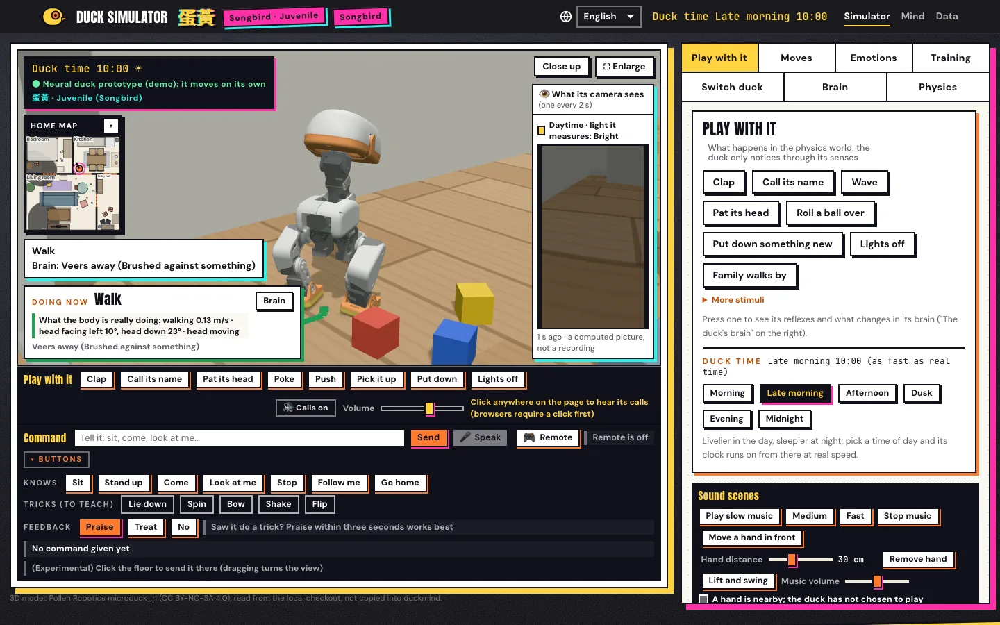

**English** | [繁體中文](README.zh-Hant.md) | [简体中文](README.zh-Hans.md) | [Español](README.es.md) | [Français](README.fr.md) | [日本語](README.ja.md) | [한국어](README.ko.md)

# duckmind

duckmind gives a small robot duck a mind of its own: who it is, its moods, its
memories, the people it knows, what it wants to do, and what it learns. It is written
for robots compatible with Microduck, and comes with a simulator you can open in your
browser.

> **Unofficial project.** duckmind is not affiliated with, endorsed by, or sponsored
> by Pollen Robotics. Microduck is a name of Pollen Robotics. duckmind uses Pollen's
> open-source code, robot model and policies, which you download from their upstream
> sources during setup.

## See it

<p align="center"></p>

|  |  |  |
|:---:|:---:|:---:|
| Walk | Bow | Lie low |
|  |  |  |
| Spin | Flip | Gets back up |

All screenshots and clips: [docs/media](docs/media/README.md) (licensed CC BY-NC-SA 4.0, because they show Pollen's Microduck 3D model). Everything the duck can do, sorted by kind: [docs/motions.md](docs/motions.md).

## Status

- **Simulator:** works. The duck lives, grows, walks around a simulated home, and
  remembers people, on your computer.
- **Real hardware: not validated.** duckmind has not been tested on a real robot.
  The board release is a candidate only. Read [SAFETY.md](SAFETY.md) first.

## What it is

duckmind decides *what* the duck wants to do. It does not drive the motors. Pollen's
`robotd` and its trained policies move the body, and their safety rules stay in
charge:

```text
cognition -> behavior intent -> embodied skill -> robotd -> policy -> safety -> body
                                      ^                              |
                                      +-------- robot.state --------+
```

In the simulator, MuJoCo physics replaces the body below `robotd`, so the upper
layers are the same for the simulator and a real robot.

## The simulator page speaks six languages

The simulator page is in 繁體中文 (the default), English, 日本語, Español, 简体中文
and 한국어. Switch the language on the page; everything the page, the server and the
duck's brain show follows it. Names the family gives (the duck's name, people's
names) are kept as they are.

## Quick start

You need Python 3.12 or newer, `git`, and [`uv`](https://docs.astral.sh/uv/).

```bash
git clone https://github.com/joseyarashio/duckmind.git
cd duckmind
uv run --python 3.12 --extra sim python -m duckmind.setup_cmd
```

`python -m duckmind.setup_cmd` downloads what duckmind uses but does not ship:

- Pollen's `microduck` code (robotd and the duck's sounds) at a pinned commit,
- Pollen's `microduck_rl` code and 3D robot model at a pinned commit. The 3D meshes
  are licensed CC BY-NC-SA 4.0 (non-commercial). setup shows that licence and
  downloads them only if you type "yes",
- Pollen's v5 policy set from Hugging Face, checked file by file against pinned
  sha256 values.

Files go under `~/.duckmind` by default (`DUCKMIND_HOME` changes that). setup never
changes something that is already there.

Then start the simulator page. setup prints this command with your own path:

```bash
uv run --python 3.12 --extra sim python -m duckmind.simweb --port 8765 \
  --microduck-mjcf ~/.duckmind/upstream/microduck_rl/src/mjlab_microduck/robot/microduck
# open http://127.0.0.1:8765/
```

The server listens only on your own computer. More in
[docs/validation/run-duck-simulator.md](docs/validation/run-duck-simulator.md); live
physics with robotd is in [docs/validation/run-live-sim.md](docs/validation/run-live-sim.md).

The cloud voice (Google Gemini Live) is off by default. Read [PRIVACY.md](PRIVACY.md)
before you turn it on.

## Documentation

- [Architecture](architecture.md) and the [source review](docs/architecture-review.md)
- Contracts: [embodied skills](docs/contracts/embodied-skill.md),
  [System 1 / System 2](docs/contracts/system1-system2.md),
  [memory](docs/contracts/memory.md), [provenance](docs/contracts/provenance.md),
  [simulator](docs/contracts/simulator.md)
- [Upstream validation](docs/upstream-validation.md)
- Running: [the simulator page](docs/validation/run-duck-simulator.md),
  [live physics](docs/validation/run-live-sim.md),
  [the pet simulation](docs/validation/run-pet-sim.md)
- Checks: [replay and adversarial validation](docs/validation/replay-adversarial.md),
  [learning crash recovery](docs/validation/learning-crash-recovery.md),
  [robotd candidate comparison](docs/validation/robotd-candidate.md)
- Training: [off-board RL](docs/training/official-rl.md),
  [local CPU training](docs/training/local-cpu.md)
- The board: [deployment](docs/deploy/board.md), [offline release](docs/deploy/release.md),
  [ready-to-burn gates](docs/ready-to-burn.md)
- The page: [six languages](docs/i18n.md), [design standard](docs/simulator-style.md)

## Development

```bash
uv run --python 3.12 --extra dev pytest
uv run --python 3.12 --extra dev ruff check src tests
uv run --python 3.12 --extra dev ruff format --check src tests
uv run --python 3.12 --extra dev mypy
```

Extras: `sim` (MuJoCo physics), `train` (policy training with mjlab), `kws` (the
name keyword detector). Read [CONTRIBUTING.md](CONTRIBUTING.md) before you send a
change; coding agents also read [AGENTS.md](AGENTS.md). Security problems:
[SECURITY.md](SECURITY.md).

## Licence

duckmind is licensed under the Apache License, Version 2.0. See [LICENSE](LICENSE),
[NOTICE](NOTICE) and [THIRD_PARTY.md](THIRD_PARTY.md).

Some third-party material is not Apache-2.0 and is not in this repository. The most
important: the Microduck 3D meshes are CC BY-NC-SA 4.0 (non-commercial only); setup
downloads them from Pollen's repository only after you accept that licence. The test
voices in `tests/fixtures/voice/` were made with Qwen3-TTS (Apache-2.0). The
recordings in `tests/fixtures/live/` are Gemini model output, kept for tests only.
