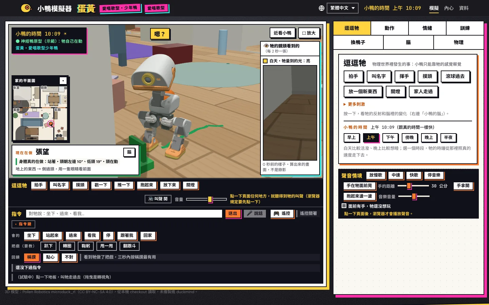

[English](README.md) | [繁體中文](README.zh-Hant.md) | **简体中文** | [Español](README.es.md) | [Français](README.fr.md) | [日本語](README.ja.md) | [한국어](README.ko.md)

# duckmind

duckmind 让一只小机器鸭有自己的心：它是谁、它的心情、它的记忆、它认识的人、它想做什么，
还有它学到的东西。它是为兼容 Microduck 的机器人写的，附带一个在浏览器里就能打开的模拟器。

> **非官方项目。** duckmind 与 Pollen Robotics 无关，没有得到 Pollen Robotics 的认可或赞助。
> Microduck 是 Pollen Robotics 的名称。duckmind 会用到 Pollen 的开源代码、机器人模型和策略，
> 这些都是安装时从上游来源下载的。

## 看看它

<p align="center"></p>

|  |  |  |
|:---:|:---:|:---:|
| 走路 | 鞠躬 | 趴低 |
|  |  |  |
| 转圈 | 翻跟斗 | 摔倒后站起来 |

全部截图和短片：[docs/media](docs/media/README.md)（授权是 CC BY-NC-SA 4.0，因为画面里有 Pollen 的 Microduck 3D 模型）。小鸭会做的所有动作，分类列表（繁体中文）：[docs/motions.zh-Hant.md](docs/motions.zh-Hant.md)；英文版：[docs/motions.md](docs/motions.md)。

## 现状

- **模拟器：可以用。** 小鸭会在你的电脑里生活、长大、在模拟的家里走动，也会记得人。
- **真机：还没有验证。** duckmind 没有在真的机器人上测试过。板子上的版本只是候选版。
  请先读 [SAFETY.md](SAFETY.md)。

## 这是什么

duckmind 决定小鸭"想做什么"，但不直接控制电机。身体由 Pollen 的 `robotd` 和它训练好的策略来驱动，
它们的安全规则始终在上面把关：

```text
cognition -> behavior intent -> embodied skill -> robotd -> policy -> safety -> body
                                      ^                              |
                                      +-------- robot.state --------+
```

在模拟器里，`robotd` 下面的身体换成 MuJoCo 物理模拟，所以上面几层在模拟器和真机上是一样的。

## 这个项目想做什么

一句话：**让一只机器小鸭，慢慢长成一只真正属于你家的宠物。**

- 它不是遥控玩具，也不是照剧本演的机器人。它每一个动作，都是自己"感觉到什么、想要什么"之后决定的。
- 它只能用自己的感官：眼睛（镜头）、耳朵、距离传感器、身体的感觉。模拟器里的"标准答案"（东西真正在哪、地图长什么样），它一律看不到，跟真的小鸭一样。
- **神经鸭是活的界面，成长才是核心。** 每一刻的反应（被吓到、好奇、想睡、想玩）由"神经鸭"的大脑负责；一天一天会长成什么样子，由"Duck Core"的成长机制负责。两个缺一不可。

### 每一只都不一样：随机种子

- 孵化的时候给它一个数字，叫"种子"。同一个种子长出同样的基因；换一个种子，就是另一只鸭。
- 种子决定它一开始的个性倾向（比较黏人、比较爱探索、比较慢吞吞爱做梦…）、动作的快慢和随机程度，还有它自己的一套叫声。
- 种子只是起点。之后它遇到什么、家人怎么对它，会让它往不同方向"发散"：同一个种子交给两个家庭，养一阵子以后，会变成两只不一样的鸭。
- 同样的种子、同样的经历，结果可以复现。这让研究和调试变得可能，也让"它为什么变成这样"查得到原因。

### 养成：它真的会长大

- 用"成长日"算年纪，不是用开机时长：一天里醒着够久才算长大一天。
- 从雏鸭、幼鸭、少年鸭到成鸭，会做的事跟着解锁。例如翻跟头大约要到少年鸭（45 个成长日上下）才会，实际哪一天看每只鸭长得快慢。
- 你怎么照顾它，会影响它长成哪一型：好奇型、悠哉型、依偎型、爱唱歌型。
- 它会记得：认得的人、喜欢什么、哪里摔倒过要避开、家里长什么样子。
- 叫声会一代一代演变（叫声谱系）：从牙牙学语开始，家人说"乖"的那几声会被留下来，慢慢变成它自己的歌。
- 可以教把戏：叫它做，做到了马上夸它或给点零食，它就越练越会；太久没练会生疏，但学会过的不会全忘。

### 从模拟到实体：以后可以"烧进"真的小鸭

- 现在全部在电脑里的物理模拟器跑（MuJoCo 加上 Pollen 的 robotd 模拟）。身体的物理、电机的延迟、电量，都尽量照真的 Microduck 来模拟。
- **一只鸭就是一个文件**：种子、基因、成长记录、学到的东西、叫声。设计的目标是：在模拟器里养大的鸭，连上实体 Microduck 之后，就是同一只鸭换了真的身体——名字、个性、记忆、把戏都还在。
- 大脑可以留在家里的电脑，身体换成真的小鸭；同一套大脑程序，差别只在身体和感官的校准。
- **老实说：** 实体小鸭还没在真机上验证过；"小鸭文件导出／导入"和"远程身体"是规划中的功能。详见上面的"现状"一节和 [SAFETY.md](SAFETY.md)。

### 现在就能玩、能做的事

- **跟它互动：** 拍手、叫名字、摸头、扔球、抱起来、关灯，看它的反射和情绪怎么反应。
- **下指令（六种语言）：** 坐下、站起来、过来、看我、停、跟着我、回家；点地板叫它过去（试验中）；也可以切到遥控模式。
- **教它把戏：** 趴下、鞠躬、甩一甩、转圈、翻跟头，在"训练"标签页看每个把戏有多熟。
- **看它的内心：** 它现在想做什么、为什么、怕不怕、长到哪里了。
- **布置家里：** 自己摆家具、放门槛和地毯，看它怎么过门槛、绕墙、找路回家。
- **训练新动作：** 用同一套工具训练新的动作网络（mjlab，A100 或本机），装进动作表给它用。
- 完整的动作清单在 [docs/motions.md](docs/motions.md)（繁体中文：[docs/motions.zh-Hant.md](docs/motions.zh-Hant.md)）。

## 模拟器页面有六种语言

模拟器页面有繁體中文（默认）、English、日本語、Español、简体中文和 한국어。在页面上切换语言，
页面、服务器和小鸭的大脑送出的文字都会跟着换。家人取的名字（小鸭的名字、人的名字）照原样显示，不翻译。

## 快速开始

需要 Python 3.12 以上、`git` 和 [`uv`](https://docs.astral.sh/uv/)。

```bash
git clone https://github.com/joseyarashio/duckmind.git
cd duckmind
uv run --python 3.12 --extra sim python -m duckmind.setup_cmd
```

`python -m duckmind.setup_cmd` 会下载 duckmind 要用、但没有放在仓库里的东西：

- Pollen 的 `microduck` 代码（robotd 和小鸭的叫声），固定在一个锁定的版本；
- Pollen 的 `microduck_rl` 代码和 3D 机器人模型，固定在一个锁定的版本。3D 网格的许可证是
  CC BY-NC-SA 4.0（非商业）。setup 会先显示这份许可证，你输入"yes"才会下载；
- Hugging Face 上 Pollen 的 v5 策略，每个文件都会和锁定的 sha256 比对。

文件默认放在 `~/.duckmind` 下面（用 `DUCKMIND_HOME` 可以换位置）。已经存在的东西，setup 一律不改。

然后启动模拟器页面。setup 会打印出这行命令，里面是你自己的路径：

```bash
uv run --python 3.12 --extra sim python -m duckmind.simweb --port 8765 \
  --microduck-mjcf ~/.duckmind/upstream/microduck_rl/src/mjlab_microduck/robot/microduck
# 打开 http://127.0.0.1:8765/
```

服务器只在你自己的电脑上接受连接。更多说明见
[docs/validation/run-duck-simulator.md](docs/validation/run-duck-simulator.md)；
接上 robotd 的实时物理见 [docs/validation/run-live-sim.md](docs/validation/run-live-sim.md)。

云端语音（Google Gemini Live）默认是关闭的。打开之前请先读 [PRIVACY.md](PRIVACY.md)。

## 文档

- [架构](architecture.md)和[源代码审查](docs/architecture-review.md)
- 接口约定：[具身技能](docs/contracts/embodied-skill.md)、
  [System 1 / System 2](docs/contracts/system1-system2.md)、
  [记忆](docs/contracts/memory.md)、[来源记录](docs/contracts/provenance.md)、
  [模拟器](docs/contracts/simulator.md)
- [上游验证](docs/upstream-validation.md)
- 运行：[模拟器页面](docs/validation/run-duck-simulator.md)、
  [实时物理](docs/validation/run-live-sim.md)、
  [宠物模拟](docs/validation/run-pet-sim.md)
- 检查：[重放与对抗验证](docs/validation/replay-adversarial.md)、
  [学习崩溃恢复](docs/validation/learning-crash-recovery.md)、
  [robotd 候选比较](docs/validation/robotd-candidate.md)
- 训练：[离机强化学习](docs/training/official-rl.md)、
  [本机 CPU 训练](docs/training/local-cpu.md)
- 板子：[部署](docs/deploy/board.md)、[离线发行](docs/deploy/release.md)、
  [烧录前关卡](docs/ready-to-burn.md)
- 页面：[六种语言](docs/i18n.md)、[设计规范](docs/simulator-style.md)

文档大多是英文。

## 开发

```bash
uv run --python 3.12 --extra dev pytest
uv run --python 3.12 --extra dev ruff check src tests
uv run --python 3.12 --extra dev ruff format --check src tests
uv run --python 3.12 --extra dev mypy
```

额外依赖组：`sim`（MuJoCo 物理）、`train`（用 mjlab 训练策略）、`kws`（名字检测器）。
提交修改之前请读 [CONTRIBUTING.md](CONTRIBUTING.md)；写代码的 AI 代理另外读 [AGENTS.md](AGENTS.md)。
安全问题见 [SECURITY.md](SECURITY.md)。

## 使用、引用、修改：请注明作者出处

这个项目的作者是 **joseyarashio**。如果你使用、引用、改写，或拿它做衍生作品，请注明作者和出处，例如：

> duckmind，作者 joseyarashio — https://github.com/joseyarashio/duckmind

- 代码采用 Apache-2.0。按照许可证第 4 条，分发原版或修改版时，必须附上 [LICENSE](LICENSE)，保留 [NOTICE](NOTICE) 里的署名，并在改过的文件上注明你改了什么。
- 写文章或论文引用时，可以用仓库里的 [CITATION.cff](CITATION.cff)。
- 截图和视频（[docs/media](docs/media/README.md)）另外采用 CC BY-NC-SA 4.0：要署名、不能商用、改编要用相同许可证，因为画面里有 Pollen 的 3D 模型。

## 许可证

duckmind 采用 Apache License 2.0 许可证。见 [LICENSE](LICENSE)、[NOTICE](NOTICE) 和
[THIRD_PARTY.md](THIRD_PARTY.md)。

有些第三方素材不是 Apache-2.0，也不在这个仓库里。最重要的是：Microduck 的 3D 网格是
CC BY-NC-SA 4.0（只能非商业使用）；你同意这份许可证之后，setup 才会从 Pollen 的仓库下载。
`tests/fixtures/voice/` 里的测试语音是用 Qwen3-TTS（Apache-2.0）做的。
`tests/fixtures/live/` 里的录音是 Gemini 模型的输出，只用于测试。
