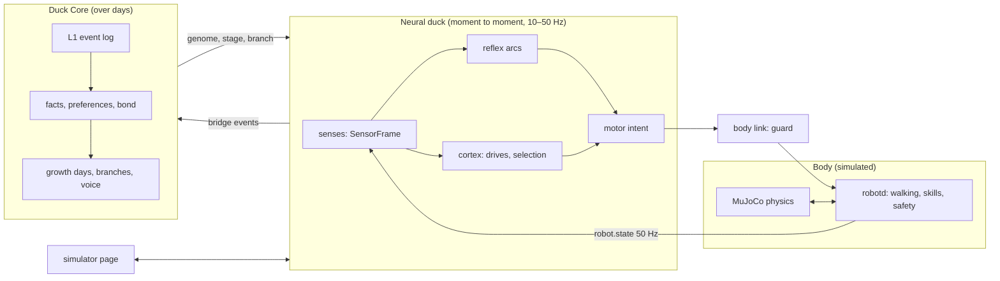

# How duckmind works

This page explains the inside of duckmind: how the duck's brain decides what to do from moment to moment, how it remembers, how it grows over days, how its motions are trained and tested — and what does not work yet. Module names are given so you can read the code next to it. For the file-level map see [architecture.md](../architecture.md); for the safety rules see [SAFETY.md](../SAFETY.md).

## 1. The big picture

- **The body** is Pollen Robotics' `robotd` controller running against MuJoCo physics. It owns walking, the trained one-shot skills (sit/stand, kicks, flinches …) and the low-level safety stops. duckmind never edits it; it talks to it over its socket like a real duck's brain would.
- **The neural duck** (`duckmind.neuro`) is the brain that runs every tick: senses → reflexes → feelings → choose a behaviour → move.
- **Duck Core** (`duckmind.duckcore`) is the slow self: what happened, what the duck remembers, who it is close to, how it grows day by day.
- **The page** (`duckmind.simweb`) shows the duck, its world and *why* it does what it does, in six languages.

## 2. The brain: reflexes and cortex

`NeuroBrain(genome, seed).step(t_ms, frame) -> (cmd, telemetry)` in `neuro/brain.py` runs six stages every tick.

### Honest senses
The brain reads only a `SensorFrame` (`neuro/contract.py`): IMU, joints, its own odometry (which drifts), the ToF distance sensor, egocentric sightings from the camera, plus world-side models of hearing and touch. It never imports the simulated world (`duckmind.world`), so it cannot "cheat" by knowing where things truly are. Everything it knows about the room it had to notice itself.

### Fast path: reflex arcs
Like a spinal reflex, these act before any deliberation and can interrupt whatever the duck is doing:

- **orienting, startle → freeze, flinch/withdrawal or leaning in** (`neuro/reflex.py`), scaled by arousal, fear and comfort, and by **habituation** (`neuro/habituation.py`: the tenth clap gets a weaker response; a real scare makes it jumpier for a while);
- **stop reflexes** in the body layer (`duckbody/reflex.py`): fell → lifted → unloaded → drop ahead → touch → stall → obstacle near → too dark, checked in that order, each a pure integer function;
- **righting** (`duckbody/righting.py`): after a fall (robotd's flag, or a tilt over 40° for 1 s) the duck holds still and gets back up;
- **stumble stop**: a trunk tilt past a limit while walking ends the step (`neuro/bodylink.py`).

### Slow path: the "cortex"
- **Appraisal** (`neuro/appraisal.py`) turns reflex events into meaning: drive impulses, traces, place learning.
- **Drives and affect** (`neuro/drives.py`): energy, sleep pressure × a circadian clock, curiosity, fear, social need, comfort, boredom, the urge to walk, battery hunger, play; arousal and mood.
- **Selection** (`neuro/select.py`) is a basal-ganglia-like competition. Each behaviour (the list is `BEHAVIOURS` in `neuro/contract.py`) is a channel whose salience is a weighted sum of drives, emotions, stimulus traces and learned values (the weight table `W` is the duck's wiring) × its temperament/stage gain × what the body can do now × satiation (`SATIATE_S`: a nap satiates over 900 s, a perk-and-tilt over 2.5 s), plus slow **seeded noise**. Channels are leaky accumulators; the winner gets a commitment bonus that fades as its bout satiates, so the duck neither dithers nor gets stuck.
- **Claims**: a family command (`neuro/command_brain.py`), an errand (`neuro/errand.py`), a learned trick (`neuro/tricks.py`) or the remote (`neuro/remote.py`) can claim the body above the competition; reflexes still win.
- **Motor intent** (`neuro/motor.py`): a locomotor rhythm of bursts and pauses with drifting speed and meandering arcs, steered by the behaviour's goal; gaze, posture, head bob, calls.

### The motor contract and the body link
Every command must be **legal** under the contract (`neuro/contract.py`, legal walk). The body link (`neuro/bodylink.py`) puts it onto robotd under the body's safety: a normal walking cap of 0.55 m/s, per-skill caps, a stumble-tilt abort (10°), and careful hand-back speeds after short "flights" — each limit is commented with the trial counts that set it. Trained skill networks (see §5) run inside robotd; the brain only asks for them.

### Why did it do that?
Every tick returns `BrainTelemetry` (`neuro/telemetry.py`): the selected behaviour, its salience and top contributing inputs, the reflex that fired, the drives. The page turns this into "what it is doing and why" in plain words.

## 3. Memory layers

| Layer | Lives | Where |
|---|---|---|
| Moment state | seconds | drives, traces, habituation in the brain |
| Short wall memory | ~25 s | `neuro/boundary.py` |
| Learner | the duck's life | `neuro/learn.py`: places (0.5 m cells: value, visits, family met), things, cues (what its name means), the nest, **people** (name given by the family, look, closeness), spots to **avoid** (3+ hard falls; one fall never makes it timid), trick proficiency |
| Lasting map | the duck's life | `neuro/lastmap.py`: a sparse 0.10 m occupancy grid built from its own senses, log-odds evidence |
| L1 events | forever, append-only | `duckcore/memory.py`: SHA-256-chained event records — the only authority |
| L2 episodes | rebuilt | visits, touch bursts, play sessions |
| L3 facts | rebuilt | each with evidence IDs and a deterministic **strength**: spaced repetition makes it stronger, time without support fades it (half-lives of 30, 60 or 90 days by kind) |
| L4 diary | rebuilt | every sentence cites its events |
| Preferences, bond, growth | rebuilt | `duckcore/engine.py` |

Forgetting appends a tombstone; rebuilding without those events is exactly "as if it never happened".

**Growth.** Duck Core counts growth days, moves through stages (hatchling → duckling → juvenile → adult) and leans toward one of four branches (`songbird`, `explorer`, `snuggler`, `dreamer`) from what it lives. Praise counts if it comes within 3 s of an act (`PRAISE_WINDOW`). The neural duck reports what it lives through bridge events (`duckcore/bridge.py`, `bridge_v2.py`); Duck Core feeds back the stage and branch, which change the brain's gains. Its **voice lineage** (`life/voice_lineage.py`) — first word, babbled phrases, praised phrases promoted after two growth days, its song — becomes a plan for the page's voice clips.

**Persistence.** The slow neural state is saved locally (`life/snapshot.py`, `SNAPSHOT_VERSION = 2`) next to Duck Core's record (`life/record.py`), with versioned migrations; older records are upgraded with a backup first (`life/upgrade.py`). Nothing is sent anywhere.

## 4. Randomness and reproducibility

- A **seed** gives a **genome** (`neuro/genome.py`): Duck Core's hatching draws — seven temperament axes, the four-branch nature, quirks like an innate head-tilt side, a favourite sound, tempo, growth pace — mapped onto the brain's gains, thresholds, time constants and motor style.
- Duck Core's randomness is counter-based (`duckcore/rng.py`): each draw is `BLAKE2b(seed ‖ table ‖ purpose ‖ counter)`, so every draw is logged and replayable, and adding a new feature cannot shift old draws. The brain uses seeded splitmix64 streams.
- Same genome + seed + sensor frames → same outputs. Two ducks with different seeds start different; two ducks with the *same* seed diverge as soon as their lives differ, because learning, facts and growth follow experience.

## 5. Motion training and tools

New motions are trained in MuJoCo (mjlab-based RL on a GPU box) and must pass `duckmind.skilltrain` on the Mac before they reach the simulator: robotd's skill table and its own validation rules (`motion_table.py`), a guard (`guard.py`), and **gates** (`gate.py`, `*_gate.py`) with fall counts, tilt and timing limits. Gates are frozen *before* training starts, so a result cannot move its own goalposts. See [motions.md](motions.md) and [training/official-rl.md](training/official-rl.md).

## 6. How it is tested

- **Headless lockstep**: the brain and body link run against the physics step by step, deterministic, in unit and scenario tests.
- **Real simulator runs** with robotd, for the end-to-end behaviour.
- **Gates with confidence intervals**: success rates are reported with Wilson intervals (`verify/aggregate.py`), not single lucky runs.
- **Not better → revert**: a change that does not beat the frozen gate is rolled back, even after much work. Several items below are honest results of that rule.

## 7. Future improvements (honest list)

- **Going to a spot** (remote "go there") arrives only about 26% of the time. Walk-tracking training was tried four times and failed its gate. Next: better path following in the brain on the lasting map, then retrain with a new reward.
- **Door sills (~20 mm)** still make it fall. Step-walk training (6 tries) and brain-side fixes failed. Next: a ramp option for the room, and a dedicated step skill.
- **Real hardware** is not validated; everything here runs in simulation. Next: bench tests on a real body with the same gates.
- **Pet file export/import** and a **remote body** are planned, not built.
- **Voice recognition**: local, six-language recognition is planned; today praise is a button. The name detector (keyword spotting) failed acceptance. Next: retrain on more local voices, never using outside services.
- **False "brushed a wall" guesses** sometimes steer walking. Next: require agreement between touch and ToF before it turns.
- **Wandering off after "stop"** or after being set down. Next: a stay intent that the competition respects.
- **Standing up takes ~1.9 s** to start (robotd's sit/stand switch). Next: a faster switch in the body layer.
- **Interface rework** into Play / Training / Growth / My duck.
- **Personality check**: a χ² test that trick obedience really differs by temperament has not been run yet.
