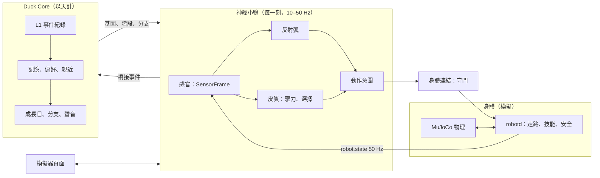

# duckmind 是怎麼運作的

這頁講 duckmind 裡面的事：小鴨的腦每一刻怎麼決定要做什麼、牠怎麼記得事情、怎麼一天一天長大、動作怎麼訓練和檢查，還有哪些地方還做不好。每一段都寫了模組名稱，可以對著程式碼看。檔案層級的地圖在 [architecture.md](../architecture.md)，安全規則在 [SAFETY.md](../SAFETY.md)。

## 1. 全貌

- **身體**：Pollen Robotics 的 `robotd` 控制器，跑在 MuJoCo 物理上。走路、訓練好的一次性技能（坐下站起、踢、縮一下……）和最底層的安全停止都歸它管。duckmind 不改它，只像真的小鴨大腦一樣透過它的通訊介面跟它講話。
- **神經小鴨**（`duckmind.neuro`）：每一拍都在跑的腦：感覺 → 反射 → 心情 → 選一個行為 → 動。
- **Duck Core**（`duckmind.duckcore`）：慢的「自我」：發生過什麼、記得什麼、跟誰親、每天怎麼長大。
- **頁面**（`duckmind.simweb`）：用六種語言給你看小鴨、牠的世界，以及牠**為什麼**這樣做。

## 2. 腦：反射和皮質

`neuro/brain.py` 的 `NeuroBrain(genome, seed).step(t_ms, frame) -> (cmd, telemetry)` 每一拍跑六步。

### 只用自己的感官
腦只讀 `SensorFrame`（`neuro/contract.py`）：IMU、關節、自己的里程計（會漂）、ToF 距離感測、相機看到的東西（以自己為中心），再加上聽覺和觸覺的模型。它從不載入模擬世界（`duckmind.world`），所以沒辦法「偷看」東西真正在哪。房間裡的事，都是牠自己注意到的。

### 快路徑：反射弧
像脊髓反射一樣，還沒想就先動，而且可以打斷正在做的事：

- **轉頭注意、嚇一跳 → 定住、縮開或靠過去**（`neuro/reflex.py`），強弱看興奮、害怕、舒服的程度，也看**習慣化**（`neuro/habituation.py`：第十次拍手反應比較小；真的被嚇到會有一陣子比較容易驚）；
- **身體層的停止反射**（`duckbody/reflex.py`）：跌倒 → 被抱起 → 腳沒踩地 → 前面有落差 → 被碰 → 卡住 → 前面太近 → 太暗，照這個順序檢查，每個都是純整數函式；
- **爬起來**（`duckbody/righting.py`）：跌倒後（robotd 說倒了，或傾斜超過 40° 持續 1 秒）先停住，再站起來；
- **絆到就停**：走路時身體傾斜超過界線就結束這一步（`neuro/bodylink.py`）。

### 慢路徑：「皮質」
- **評估**（`neuro/appraisal.py`）：把反射事件變成意義：驅力的變化、痕跡、對地點的學習。
- **驅力和情緒**（`neuro/drives.py`）：體力、睡意 × 生理時鐘、好奇、害怕、想找人、舒服、無聊、想走走、電量餓、想玩；興奮度和心情。
- **選擇**（`neuro/select.py`）：像基底核的競爭。每個行為（清單在 `neuro/contract.py` 的 `BEHAVIOURS`）是一條通道，它的強度 = 驅力、情緒、刺激痕跡和學到的價值的加權和（權重表 `W` 就是小鴨的「接線」）× 個性和階段的增益 × 身體現在做不做得到 × 飽足度（`SATIATE_S`：睡午覺 900 秒才膩，歪頭聽 2.5 秒就膩），再加上慢慢變化的**有種子的雜訊**。通道會累積也會漏掉；贏的那個有「投入加成」，隨著做膩慢慢消失，所以小鴨不會一直換來換去，也不會卡在同一件事。
- **接管**：家人的口令（`neuro/command_brain.py`）、跑腿（`neuro/errand.py`）、學會的把戲（`neuro/tricks.py`）、遙控（`neuro/remote.py`）可以蓋過競爭直接用身體；但反射還是最優先。
- **動作意圖**（`neuro/motor.py`）：走一陣停一陣、速度慢慢飄、路線會彎的走路節奏，由行為的目標來帶方向；還有眼神、姿勢、點頭、叫聲。

### 動作合約和身體連結
每個指令都要在合約裡**合法**（`neuro/contract.py` 的 legal walk）。身體連結（`neuro/bodylink.py`）在身體的安全規則下把它送給 robotd：平常走路最快 0.55 m/s、每個技能各自的上限、絆到傾斜 10° 就中止、短衝刺後小心交還速度——每個上限旁邊都註明了是哪些試驗次數決定的。訓練好的技能網路（見第 5 節）在 robotd 裡跑，腦只負責請求。

### 牠為什麼這樣做？
每一拍都回傳 `BrainTelemetry`（`neuro/telemetry.py`）：選了哪個行為、為什麼、競爭中前幾名、剛觸發的反射、各種驅力。頁面把它變成白話的「現在在做什麼、為什麼」。

## 3. 記憶的層次

| 層 | 能留多久 | 在哪裡 |
|---|---|---|
| 這一刻的狀態 | 幾秒 | 腦裡的驅力、痕跡、習慣化 |
| 短的牆壁記憶 | 約 25 秒 | `neuro/boundary.py` |
| 學習者 | 一輩子 | `neuro/learn.py`：地點（0.5 m 格子：好不好、來過幾次、在那裡遇過家人）、東西、提示（自己的名字代表什麼）、窩、**人**（家人取的名字、長相、多親）、要**避開**的地方（硬摔三次以上；摔一次不會讓牠變膽小）、把戲熟練度 |
| 長久地圖 | 一輩子 | `neuro/lastmap.py`：用自己的感官建的 0.10 m 稀疏格子地圖，用對數勝算累積證據 |
| L1 事件 | 永遠，只能往後加 | `duckcore/memory.py`：用 SHA-256 串起來的事件紀錄——唯一的依據 |
| L2 片段 | 重建 | 來訪、一陣撫摸、一段玩耍 |
| L3 記住的事 | 重建 | 每件都附證據編號和確定的**強度**：隔開重複會更牢，沒有新證據會慢慢淡掉（依種類半衰期 30、60 或 90 天） |
| L4 日記 | 重建 | 每句話都標出依據的事件 |
| 偏好、親近、成長 | 重建 | `duckcore/engine.py` |

忘記一件事是加一筆「墓碑」；不算那些事件重建，就完全「像沒發生過」。

**成長**：Duck Core 數成長日，經過幾個階段（剛孵化 → 小小鴨 → 少年 → 成鴨），並依牠過的日子偏向四個分支之一（`songbird` 愛唱、`explorer` 愛探險、`snuggler` 愛撒嬌、`dreamer` 愛發呆）。動作後 3 秒內的稱讚才算（`PRAISE_WINDOW`）。神經小鴨用橋接事件（`duckcore/bridge.py`、`bridge_v2.py`）回報牠經歷的事；Duck Core 回傳階段和分支，改變腦的增益。牠的**聲音傳承**（`life/voice_lineage.py`）——第一個字、牙牙學語、被稱讚的句子（兩個成長日後升級）、牠的歌——會變成頁面播放聲音的計畫。

**存檔**：慢的神經狀態存在本機（`life/snapshot.py`，`SNAPSHOT_VERSION = 2`），旁邊是 Duck Core 的紀錄（`life/record.py`），有版本和遷移；舊紀錄升級前會先備份（`life/upgrade.py`）。什麼都不會送出去。

## 4. 隨機和可重現

- **種子**決定**基因**（`neuro/genome.py`）：Duck Core 孵化時抽的東西——七個個性軸、四分支的天性、小怪癖（天生歪頭的方向、最愛的聲音、節奏）、長大的速度——對應到腦的增益、門檻、時間常數和動作風格。
- Duck Core 的隨機是以計數器為準（`duckcore/rng.py`）：每次抽是 `BLAKE2b(種子 ‖ 表 ‖ 用途 ‖ 計數)`，所以每次都有紀錄、能重播，加新功能也不會改到舊的抽籤。腦用有種子的 splitmix64 串流。
- 一樣的基因 + 種子 + 感測資料 → 一樣的輸出。不同種子的小鴨一出生就不同；**同一個**種子的兩隻，只要生活不一樣就會分岔，因為學習、記憶和成長跟著經歷走。

## 5. 動作訓練和工具

新動作在 MuJoCo 裡訓練（用 mjlab 在 GPU 機器上做強化學習），在 Mac 上要先通過 `duckmind.skilltrain` 才能進模擬器：robotd 的技能表和它自己的檢查規則（`motion_table.py`）、守門（`guard.py`），以及**關卡**（`gate.py`、`*_gate.py`）：跌倒次數、傾斜、時間的上限。關卡在訓練**開始前**就凍結，結果不能自己移動球門。見 [motions.zh-Hant.md](motions.zh-Hant.md) 和 [training/official-rl.md](training/official-rl.md)。

## 6. 怎麼測試

- **無畫面同步步進**：腦和身體連結跟物理一步一步一起跑，結果確定，用在單元和情境測試。
- **真的模擬器**配 robotd，看完整的行為。
- **有信賴區間的關卡**：成功率用 Wilson 區間報告（`verify/aggregate.py`），不靠一次好運。
- **沒有比較好 → 退回**：沒贏過凍結關卡的改動就退回，就算花了很多功夫。下面好幾項就是這條規則的誠實結果。

## 7. 以後要改進的地方（老實說）

- **走到指定地點**（遙控「去那裡」）只有約 26% 會到。走路追蹤訓練試了四次都沒過關。下一步：先讓腦在長久地圖上跟路線跟得更好，再換新的獎勵重訓。
- **門檻（約 20 mm）**還是會讓牠跌倒。跨步訓練試了 6 次、腦這邊的修法也沒成功。下一步：房間可以放斜坡，以及專門的跨步技能。
- **真的硬體**還沒驗證過；這裡全部在模擬裡跑。下一步：在真的身體上用同樣的關卡做台架測試。
- **寵物檔匯出／匯入**和**遠端身體**在計畫中，還沒做。
- **聽懂聲音**：計畫做本機、六種語言的語音辨識；現在稱讚是按按鈕。名字偵測（關鍵字辨識）沒通過驗收。下一步：用更多本機錄的聲音重訓，絕不用外部服務。
- **誤以為「擦到牆」**有時會讓走路轉向。下一步：觸覺和 ToF 都同意才轉。
- **說「停」或被放下後會走開**。下一步：一個競爭會尊重的「待著」意圖。
- **站起來要約 1.9 秒才開始**（robotd 的坐站切換）。下一步：身體層更快的切換。
- **介面重整**成「玩／訓練／成長／我的小鴨」。
- **個性檢查**：還沒跑 χ² 檢定確認把戲聽不聽話真的跟個性有關。
